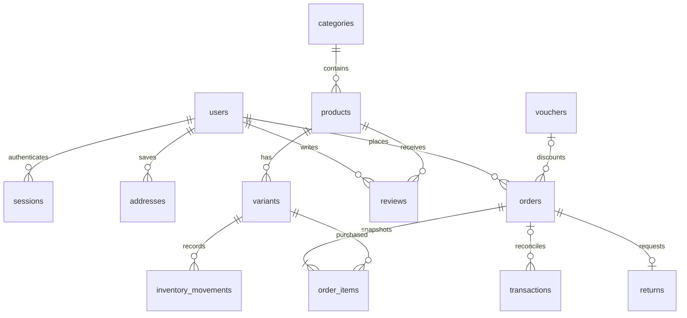

# Database & tính toàn vẹn

Drizzle schema: `src/db/schema.ts`; SQL migrations phiên bản trong `drizzle/`. Không dùng schema push/reset lên dữ liệu bán hàng.

Migration 0002 thêm `products.images` (mảng JSON có thứ tự), giữ `image` làm ảnh bìa tương thích và backfill từ ảnh cũ. Tạo/sửa sản phẩm cập nhật hai trường trong cùng transaction. Slug tự sinh phía server, xử lý tên trùng dưới advisory transaction lock; đổi tên giữ slug cũ. Tạo mới sản phẩm cũng tạo biến thể và ghi sổ tồn kho ban đầu trong cùng transaction.

Giá VND dùng integer. Order item giữ tên, SKU, ảnh, màu, size, giá, số lượng tại lúc mua. Order giữ địa chỉ, phí giao hàng, ưu đãi và tổng. Không truy ngược giá sản phẩm hiện tại để tính lịch sử.

Tồn kho là số có thể bán; checkout giảm ngay khi giữ chỗ. Row lock theo thứ tự variant ID; voucher có row lock riêng. Hủy/hết hạn hoàn kho đúng một lần nhờ khóa order và kiểm tra chuyển trạng thái. Checkout dùng advisory lock cho idempotency key. Gửi lại cùng key bị từ chối tạo đơn mới; nếu mất phản hồi, người đăng nhập kiểm tra lịch sử, khách vãng lai cần hỗ trợ từ cửa hàng.

Webhook insert transaction unique trước, khóa order, kiểm tra và cập nhật cùng transaction. `test` tách đơn mô phỏng khỏi tiền thật. Trạng thái giao hàng và thanh toán tách biệt. COD chỉ ghi nhận thu tiền sau khi trạng thái hoàn thành, có audit.

Mật khẩu scrypt + salt ngẫu nhiên. Session token 256-bit lưu hash, có hạn 7 ngày, cookie HttpOnly/SameSite; Secure khi APP_URL HTTPS. Order guest token 256-bit lưu hash; trình duyệt giữ bản gốc trong localStorage. Không chia sẻ token.

API mutation kiểm tra Origin; quyền được kiểm tra ở backend. Zod kiểm tra input. ORM parameterizes truy vấn. Ảnh upload được decode/re-encode bằng sharp, giới hạn dung lượng/pixel, không chấp nhận SVG từ người dùng. Admin upload không trả đường dẫn filesystem. Rate limits lưu DB.

Đổi schema: chỉnh schema → `npm run db:generate` → xem SQL → backup → `npm run db:migrate`. Seed chỉ insert thiếu. Test database `cozy_pajamas_test` riêng, không xóa database bán hàng.
